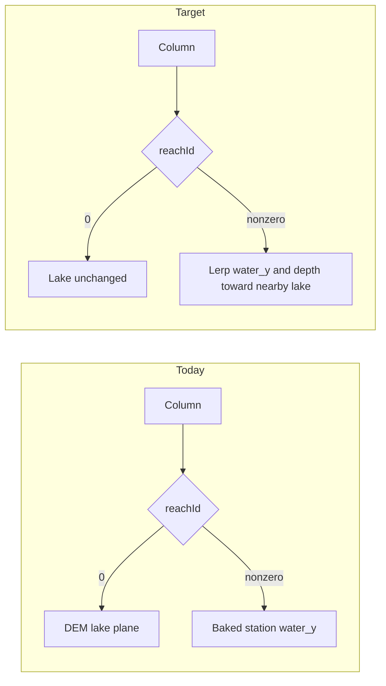

# Fix river bank spikes and lake–river depth blend

## What’s going wrong

Screenshots show two separate failures:

1. **Sawtooth / fan spikes along streams** — Station stamps are thin oriented rectangles (`±ALONG_LIMIT` along flow × `±(half_width+12.5)` across), but the ownership winner uses **Euclidean distance to the station point**. At the banks that produces radial Voronoi wedges and rotated-rectangle corners, especially on bends. Each winning cell gets a flat `water_y`, so adjacent wedges look like triangular land/water spikes.

```698:716:tools/ukgeo-tools/src/ukgeo/river_stations.py
    # inside = oriented rectangle (along/perp)
    dist_milli = np.floor(np.hypot(dx, dz) * 1000.0 + 0.5)  # Euclidean → fan spikes
```

2. **Hard lake ↔ river cliffs** — Runtime switches on `reachId == 0` with **no water_y lerp**. Corridor freshwater uses baked station Y; non-corridor freshwater uses the DEM lake plane. Only a short lake-side bed tweak (`riverLakeMouthDepth`, ~5 blocks) exists, and it deepens the **lake toward the river**, which is the wrong direction for “lakes keep their deepness.”

```33:38:mods/ukgeo/src/main/java/com/ukgeo/worldgen/RiverStationColumn.java
    // stations on → lake only when reachId == 0
```

```770:780:mods/ukgeo/src/main/java/com/ukgeo/worldgen/UkGeoChunkGenerator.java
    // freshwaterUsesLake → lake plane; else computeRiverShape (baked water_y)
```



## Approach (locked)

### A. Bake: cross-track ownership (fixes spikes)

In [`tools/ukgeo-tools/src/ukgeo/river_stations.py`](tools/ukgeo-tools/src/ukgeo/river_stations.py) `_stamp_one`:

- Keep the oriented rectangle eligibility (`along` / `perp`).
- Change ownership distance from `hypot(dx,dz)` to **`abs(perp)` millicells** (still clipped to 24 bits). Lexicographic min stays `(dist, -order, reach_id, station_id)`.
- Bump `ALONG_LIMIT` from `1.0` → **`1.5`** so neighboring stamps overlap more on bends and the outer corridor union is less diamond-toothed.
- Update docstring + tests in [`tools/ukgeo-tools/tests/test_river_stations.py`](tools/ukgeo-tools/tests/test_river_stations.py):
  - Ownership still order-independent.
  - Add a bend/bank case asserting ownership boundaries prefer lower `|perp|` (no radial fan preference over a closer cross-track neighbor).

Wet channel outline at runtime already comes from the river distance field + `halfWidth`; this change mainly cleans **which `water_y` owns the bank carve corridor**.

### B. Runtime: river → lake mouth blend (fixes cliffs)

In [`mods/ukgeo/src/main/java/com/ukgeo/worldgen/UkGeoChunkGenerator.java`](mods/ukgeo/src/main/java/com/ukgeo/worldgen/UkGeoChunkGenerator.java):

- Keep non-corridor freshwater (`reachId == 0`) on the pure lake path — **lakes persist**.
- When computing a station corridor shape near an effective lake, blend toward the lake:
  - New radius constant ~**32** blocks (smoothstep fade).
  - `waterY = round(lerp(bakedWaterY, lake.waterSurfaceY(), t))`
  - `depth = max(riverDepth, round(lerp(riverDepth, lakeDepthSample, t)))` so the river **deepens to meet the lake**, not the reverse.
- Apply the blended plane in `RiverStationColumn.resolve` inputs (or a thin wrapper) so bank `conformBankTop` uses the same plane.
- Retarget or replace `riverLakeMouthDepth` so it no longer pulls lake beds toward shallow river depth inside the lake core; lake-core depth stays lake-driven.
- LOD/debug path around ~2613–2659 that duplicates freshwater station vs lake branching should use the same blend helper.
- Tests: [`RiverWaterPlaneTest`](mods/ukgeo/src/test/java/com/ukgeo/worldgen/RiverWaterPlaneTest.java) / [`RiverStationColumnTest`](mods/ukgeo/src/test/java/com/ukgeo/worldgen/RiverStationColumnTest.java) + a small generator-facing unit test for the lerp helper if extracted as a package-visible static.

### C. Rebuild + deploy

- Stations-only rebake (`--resume-tiles`, 12 workers, `TMPDIR=/home/zenyfh/tmp`) — ownership/`water_y` tiles change; distance/half_width layers stay.
- Deploy ukgeo jar + data; **wipe server world** again (station ownership geometry changed).
- Bump mod version patch (e.g. 2.10.0 → 2.10.1) so client/server pick up the runtime blend.

## Out of scope

- Re-deriving river centerlines / half_width rasters.
- Changing lake DEM surface sampling itself.
- Create `wand_of_symmetry` join issue (separate).
